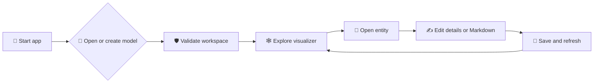

# HASM Desktop Model Editor 🌿

HASM is a local model format for organizing **people, experiences, facts, and links**. This desktop app helps you create or open a model, explore it as a graph, and edit its entities. 🧩

> **In short:** choose a model folder → explore its graph → create or edit entities → save locally. 📂🔎✍️

## 🖥️ About the HASM desktop app

The **HASM Desktop Model Editor** is a local-first workspace for structuring and exploring a person’s experiences and the facts connected to them. It brings a 3D graph view and editable entity details together in one desktop application. 🧭

### 🧩 The four model building blocks

| Type | What it represents |
|---|---|
| 👤 **PERSON** | A person at the center of a model. |
| 🌱 **EXPERIENCE** | A timeline or context for organizing experiences; experiences can form branches. |
| 📍 **FACT** | An event or piece of information, optionally associated with one or more experiences. |
| 🔗 **LINK** | A directed relationship between model entities. |

Together, these entities form a connected model that you can browse visually, rather than a collection of disconnected notes. 🕸️

### 💾 Local files, readable Markdown

Each entity has a folder containing a human-readable `main.md` file and an `assets/` folder for related media. A local SQLite database stores structured metadata and relationships, helping the app load, edit, and visualize the model. HASM Markdown files can also be opened in the companion editor; after external edits, refresh the entity in the desktop app to load the latest content. 📝

### 🧭 Typical workflow

1. 📂 Open an existing model folder or create a new workspace.
2. 🛡️ Let HASM validate the workspace and load its data.
3. 🕸️ Explore people, experiences, facts, and links in the visualizer.
4. ➕ Create entities and relationships, or open an entity to inspect it.
5. ✍️ Edit its details or Markdown, then save or refresh the view.

## ✨ What the app can do

| Feature | Status | What it means |
|---|---:|---|
| 🚀 App and model checks | ✅ | Check the HASM Markdown app and validate a selected model before use. |
| 📂 Open or create a model | ✅ | Choose an existing workspace or scaffold a new one. |
| 🕸️ Explore the model | ✅ | View entities in the 3D visualizer, with layout filters and scope controls. |
| ➕ Create entities and links | ✅ | Create PERSON, EXPERIENCE, FACT, and LINK records; invalid creation is rejected and failed writes are rolled back. |
| 📝 View and edit entity details | ✅ | Load entity details and save metadata to the local model database. |
| 🔄 Work with Markdown | ✅ | Open the companion HASM Markdown app, detect external file changes, and refresh the displayed content. |
| 🛡️ Navigation and recovery | ✅ | Protect model-dependent routes and guide users through model and Markdown error states. |

Automated frontend, IPC-contract, and Rust tests cover the documented evaluation flows. Some full desktop/GUI scenarios remain manual acceptance checks; the visualizer geometry smoke test is opt-in. See [`docs/eval/`](docs/eval/) for coverage details. 🧪

## 🔄 How it works



## 🛠️ Technology

[](https://react.dev/)
[](https://vite.dev/)
[](https://tauri.app/)
[](https://www.rust-lang.org/)
[](https://www.sqlite.org/)

* 🖥️ **Frontend:** React, Vite, and Three.js
* ⚡ **Desktop app and IPC:** Tauri 2
* 🦀 **Backend:** Rust
* 🗃️ **Model storage:** folders, Markdown, and a local SQLite database (`main.db`, with legacy `hasm.db` support)
* 🎨 **Theme helpers:** `src/hasm_color_pattern`
* 📝 **Logging helpers:** `src/hasm_logger`

## ▶️ Get started

### Requirements

Install [Node.js](https://nodejs.org/), [Rust](https://www.rust-lang.org/tools/install), and the platform prerequisites for [Tauri](https://tauri.app/start/prerequisites/).

### Set up and run

```bash
git clone --recurse-submodules https://github.com/HibiyaHaraki/hasm.git
cd hasm
npm install
npm run tauri dev
```

If you already cloned without submodules, initialize them before building:

```bash
git submodule update --init --recursive
```

### Build

```bash
npm run build
npm run tauri:build
```

`npm run build` syncs the Tauri icons, builds and stages the `hasm_markdown` companion app, then builds the frontend. `npm run tauri:build` packages the desktop app. 📦

## 🧪 Tests

Run the complete sequence-aligned frontend evaluation suite:

```bash
npm run test:seq-md
```

Run a focused frontend evaluation:

```bash
npm run test:eval-01
npm run test:eval-02
npm run test:eval-03
npm run test:eval-04
npm run test:eval-05
npm run test:eval-07
npm run test:eval-08
```

The Rust command tests are run from `src-tauri`:

```bash
cargo test app_commands
cargo test model_commands
cargo test visualizer_commands
cargo test entity_editor_commands
cargo test external_editor_commands
cargo test switches_workspace_cleanly_with_and_without_lock_release
cargo test entity_creation_commands
```

## 📁 Project map

```text
src/
├── features/hasm/          # Workspace, entity, and Tauri API flows
├── hasm_color_pattern/      # Color patterns and theme helpers
├── hasm_logger/             # Frontend logging helpers
├── hasm_visualizer/          # Reusable 3D visualizer
└── pages/                   # Application screens
src-tauri/
├── src/hasm/                 # Rust commands, model, and services
├── src/hasm_logger/          # Rust logging helpers
└── icons/                    # Tauri app icons (generated from the logo source)
hasm_logo/                    # Logo assets and generators
docs/
├── arch/                     # Architecture and sequence documentation
├── req/                      # Requirements
└── eval/                     # Evaluation plans and test coverage
test/                         # Frontend, IPC, and visualizer tests
scripts/                      # Build and icon-sync scripts
```

## 📚 More information

The architecture, requirements, and evaluation documents are under [`docs/`](docs/). Start with the [system overview](docs/arch/01-system-overview.md), [directory structure](docs/arch/02-directory-structure-overview.md), and [evaluation plans](docs/eval/).

## 🤝 Contributions

HASM is still under active development, and external contributions are not being accepted at this time. Thank you for your interest and understanding. 💚

## 📜 License

This project is licensed under the GNU General Public License v3.0. See [LICENSE](LICENSE) for details.
