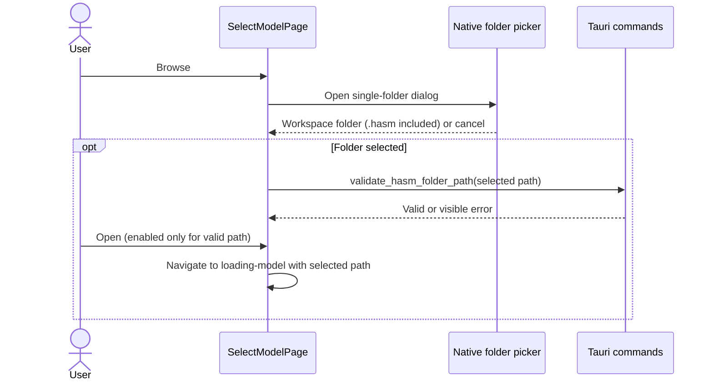

# SEQ-02: Model Loading & Storage Verification (Architecture Sequence)

This document details the complete sequence for checking and managing workspace lock files (including stale lock auto-recovery and graceful release on window close), loading metadata from `hasm.db` into the `HasmModel` Rust domain class with granular progress streaming (`current`, `total`, `percentage`), Watchdog Timeout handling (Pattern B), and executing encapsulated storage verification via `model.verify_storage()`.

---

## 1. Data Contracts & Time Constraints

### Workspace selection

The **Open a workspace** page offers manual path entry and a **Browse** button.
Browse uses `browseWorkspaceDirectory` and the Tauri dialog plugin's native
`open({ directory: true, multiple: false })` picker, not the Save dialog used
for creating a workspace. Both ordinary workspace folders and folders ending
in `.hasm` use the existing directory-based format; no archive import is added.
Selection fills the path field and disables Open until the existing debounced
`validate_hasm_folder_path` invoke accepts it. The user then presses **Open**
to enter the unchanged lock/load/verify flow. Cancellation preserves the current
path and validation; duplicate picker requests are blocked, and dialog errors
are logged with `[SEQ-MD-02][SELECT]` and displayed on the page.



### 1.1 IPC Data Definitions (Rust / TypeScript Interface)

```rust
// Payload for check_workspace_lock command
#[derive(Debug, Serialize, Deserialize)]
pub struct CheckWorkspaceLockRequest {
    pub path: String,
}

// Response payload for check_workspace_lock
#[derive(Debug, Serialize, Deserialize)]
pub struct LockStatus {
    pub is_locked: bool,
    pub holder_pid: Option<u32>,
    pub is_stale_recovered: bool, // True if a stale lock file from a crashed PID was cleaned
    pub is_read_only: bool,
}

// Payload for release_workspace_lock command (invoked explicitly or on window close)
#[derive(Debug, Serialize, Deserialize)]
pub struct ReleaseWorkspaceLockRequest {
    pub path: String,
}

// Event payload for progress streaming
#[derive(Debug, Serialize, Deserialize)]
pub struct ProgressPayload {
    pub step: String, // DB_LOAD, DB_SYNC, DB_LOAD_PERSON/EXPERIENCE/FACT/LINK, STORAGE_VERIFY
    pub current: usize,
    pub total: usize,
    pub percentage: f32,
    pub message: String,
}

```

### 1.2 Time Constraints Policy Matrix

| Operation | Timeout Rule | Timeout Value | Timeout Action & Rollback |
| --- | --- | --- | --- |
| **Workspace Lock Check & Recovery** (`check_workspace_lock`) | Fixed Hard Timeout | **3,000 ms** | Fail lock acquisition; notify UI and navigate to `/error-model`. |
| **Database Load Stream** (`load_hasm_model_db`) | Watchdog Timer (Pattern B) | **10,000 ms** (Without event) | Terminate load attempt; reject IPC; navigate to `/error-model`. |
| **Storage Verification Stream** (`verify_hasm_storage`) | Watchdog Timer (Pattern B) | **10,000 ms** (Without event) | Abort verification; reject IPC; navigate to `/error-model`. |
| **Workspace Lock Release** (`release_workspace_lock`) | Window Close Sync Lock | **1,000 ms** | Force remove `.hasm/lock` file and terminate app process. |

### 1.3 Large Package Performance Budget

The reference large package is **60,000 entities** (approximately 15,000 per entity type). All budgets assume a release build on local SSD storage and are measured from `load_hasm_model_db` invocation to the verified completion screen. Time spent waiting for the user's Go to visualization action is excluded.

| Phase | Cost Model | Budget (60,000 entities) | Design Constraint |
| --- | --- | --- | --- |
| **Workspace lock check** | O(1) | < 100 ms | Refresh only the recorded `holder_pid`; never snapshot the whole OS process table. |
| **Folder bootstrap** (`sync_directories_to_db`) | O(N) directory entries, O(M) inserts where M = folders absent from the database | < 5 s cold, < 1 s warm | Single transaction, cached prepared statements, and an existing-ID set so an unchanged package issues zero INSERTs. |
| **Metadata load** (`load_people` / `load_experiences` / `load_facts` / `load_links`) | O(N) indexed row reads | < 5 s | Index-ordered scan; entity Markdown bodies are **not** read from disk. |
| **IPC serialization** | O(N) metadata fields | < 2 s | Payload is metadata only; the Markdown corpus never crosses the bridge during SEQ-02. |
| **Storage verification** (`verify_hasm_storage`) | O(N) stat calls + O(N) set lookups | < 5 s | Expected paths are held in a hash set; a linear scan per folder would be quadratic. |
| **Entity edit round trip** (SEQ-04) | O(1) | < 300 ms | Detail read and save bootstrap only the addressed entity row. |
| **Freshness poll** (`check_entity_mtime`) | O(1) | < 10 ms | Stats the conventional entity path; the database is opened only for non-default description paths. |

**Storage engine settings applied on every connection** (`service::open_connection`): `journal_mode = WAL`, `synchronous = NORMAL`, `temp_store = MEMORY`, `cache_size = -65536`, `foreign_keys = OFF`.

**Deferred (not yet in budget):** the SEQ-03 Three.js scene still allocates one canvas-backed sprite label per node and the entity list still renders one DOM node per entity. Both remain unbounded at 60,000 entities and are tracked separately from the SEQ-02 load path.

---

## 2. Lock File Lifecycle & Stale Recovery Rules

1. **Active Lock Check:** When inspecting `.hasm/lock`, Rust reads the recorded Process ID (`holder_pid`).
   If it equals the current process ID, retain the existing lock and return
   writable status without treating it as stale or as another writer. This is
   the normal path when a saved ticket returns through SEQ-02 re-verification.
2. **Stale Lock Auto-Recovery:** If the recorded `holder_pid` is no longer active in the OS process table (e.g., prior app crash or SIGKILL), Rust removes the stale lock file, logs the cleanup, and acquires a fresh lock (`is_stale_recovered = true`).
3. **Graceful Release on Window Close (Top-Right "X"):** Tauri's window `tauri://close-requested` event is intercepted. The app executes `release_workspace_lock` (deleting `.hasm/lock`) before exiting the desktop process.

### Per-stage loading display

`LoadingModelPage` defaults to a compact numbered stepper with **Prepare progress
listeners**, **Check workspace lock**, **Load database metadata**, and **Verify
workspace storage**. Each step shows Waiting, In progress, or Complete, and the
active item has `aria-current="step"`. No progress bars are exposed by default.
**Show detail** expands nine accessible bars: the four main stages plus folder
synchronization and separate PERSON, EXPERIENCE, FACT, and LINK database loads.
**Hide detail** collapses them without restarting work or discarding progress.

The lock check, database load, and storage verification commands are asynchronous
IPC entry points. Each awaits a `tauri::async_runtime::spawn_blocking` worker for
its synchronous process-table, SQLite, and filesystem work; none runs that work
on the Tauri main thread. Worker join failures are logged with SEQ-MD-02 tags and
returned as IPC errors. Command names, payloads, ordering and progress events are
unchanged. Scrolling and Show/Hide detail remain available while commands are
pending; collapsing details only changes visibility, not worker execution.

The existing event payload shape is unchanged. `model-load-progress` now uses
`DB_SYNC`, `DB_LOAD_PERSON`, `DB_LOAD_EXPERIENCE`, `DB_LOAD_FACT`, and `DB_LOAD_LINK`
as explicit substage identifiers, alongside initial/final `DB_LOAD` events.
The staged service reader counts each entity table separately and reports
current/total relative to that type. Stage boundaries always emit even below
the 150ms throttle; empty types emit 0/0 with finite 100% completion. The
database summary percentage weights the five substages equally. Storage still
uses `model-verify-progress` with `STORAGE_VERIFY`.

Listener setup and lock checking are binary, not estimated. Completed bars remain
at 100%. A later native substage confirms completion of earlier substages; database
command resolution confirms all metadata stages, and verification resolution
confirms storage. A 100% event alone never enables continuation. Late events from
an earlier stage cannot overwrite completed progress or extend the next watchdog.
Invalid percentages are logged and ignored without refreshing the watchdog.

After verification succeeds for a populated model, the page releases listeners
and clears timers, stores the verified model/read-only/warning context in page
state, and shows **Workspace ready** and **Go to visualization**. It stays at
`/loading-model` indefinitely without watchdog errors until the user presses that
button. The click navigates to `/visualizer` with the stored context and performs
no second load or verification. This also applies to return-from-save
re-verification. Empty models retain automatic routing to `/initialize-model`.
Failures retain their existing immediate error routes. All views use wrapping,
theme-aware styling, with no artificial waits.

### Navigation-Safe Load Attempts

Each `LoadingModelPage` effect owns its watchdog and progress subscriptions.
Subscription results are registered individually: a listener arriving after
unmount or after its sibling registration fails is immediately disposed.
An abandoned attempt must not check locks, load data, or change routes.
Success, error, timeout, and unmount all dispose acquired listeners and clear
the watchdog. An IPC response arriving after timeout cannot leave the error
page or start storage verification. This cancels frontend ownership, not
already-issued native operations.

The load/verify commands accept a generic Tauri runtime internally, preserving
their serialized IPC contracts while allowing the native mock-runtime
integration test to exercise the real load/verify/layout command chain.

---

## 3. Sequence Architecture Chapters

### Implemented Module Mapping

The current implementation owns the SEQ-02 backend IPC in `src-tauri/src/hasm/model_commands.rs` and the frontend lifecycle in `src/pages/LoadingModelPage.jsx`. The Rust loader returns the existing serialized `ModelDatabase` payload, and the frontend transfers that verified payload to `/visualizer`. Tests create a populated temporary `hasm.db` with PERSON, EXPERIENCE, FACT, and LINK rows plus non-empty matching `main.md` and `assets/` folders; no empty workspace fixture is used.

`load_hasm_model_db` streams `model-load-progress` per row via `service::read_model_database_with_stage_progress` (in `src-tauri/src/hasm/service.rs`). Emits are time-throttled (`PROGRESS_EMIT_INTERVAL`, 150 ms), except stage starts/completions, so large HASM packages report continuous progress without flooding IPC and small/empty stages remain observable. The existing `read_model_database_with_progress` callback API delegates to this reader for non-IPC callers. `verify_hasm_storage` applies the same time-based throttle to its per-entity emits, and its `find_unreferenced_entity_folders` folder scan also streams `model-verify-progress` per scanned folder.

#### Large Package Load Path

The following implementation decisions realise the §1.3 budget:

* **Metadata-only load.** `read_model_database_with_progress` takes an `include_markdown` flag. `load_hasm_model_db` passes `false`, so SEQ-02 performs zero `main.md` reads and the returned `ModelDatabase` carries `markdown_path` with an empty `markdown`. SEQ-04's `load_entity_detail` reads the body for the single opened entity; `service::read_model_database` (used by `commands::read_model_database` and by tests) still returns full bodies.
* **Transactional, diff-based folder bootstrap.** `sync_directories_to_db_with_progress` reads the existing ID set per table, opens one transaction, and executes cached `INSERT OR IGNORE` statements only for folders that have no row. It also streams progress, closing the previously silent gap before the load loops.
* **Constant-time edit bootstrap.** `ensure_entity_row` replaces the whole-package folder sync in all four `get_*_detail` and all four `save_*_detail` service functions, so an edit no longer scales with package size.
* **Indexed list ordering.** `ensure_schema` creates expression indexes matching each list `ORDER BY COALESCE(NULLIF(<name>, ''), <id>)` key plus `idx_experience_person`, replacing a full temporary B-tree sort per entity type per load.
* **Linear storage verification.** `find_unreferenced_entity_folders` resolves expected paths through a `HashSet`; the previous per-folder `Vec` scan was quadratic in entity count.
* **Targeted process lookup.** `process_is_active` refreshes only the recorded lock PID instead of building a full `System::new_all()` snapshot.
* **Linear layout indexing.** `visualizer_commands::calculate_layout` builds an experience-by-id map and a children-by-parent map once, removing the per-experience linear scans (ancestor walk, parent lookup, sibling grouping) that made SEQ-03 layout quadratic.

#### Schema Note: Experience Ownership

`experience.person_id` no longer declares a SQL `REFERENCES person(person_id)` constraint, and `foreign_keys` is left `OFF`. Folder-only EXPERIENCE entities are bootstrapped with the nil-UUID owner placeholder before their owning PERSON is known, which made the constraint unsatisfiable for packages that carry entity folders without database rows. Ownership is validated in the domain layer instead. Legacy databases that still carry the constraint continue to open because enforcement is disabled.

### Participant Lifecycle Legend

* **User**: End user interacting with `LoadingModelPage.tsx` or closing the application window.
* **React**: `LoadingModelPage.tsx` / `App.tsx` global event listener.
* **Router**: `React Router` navigation engine.
* **Bridge**: `Tauri IPC Bridge / listen()`.
* **Rust**: `model_loader.rs` in Rust backend.
* **Model**: `HasmModel` Rust Domain Instance.
* **FS**: Local File System / Workspace Storage (`.hasm/lock`, `hasm.db`).

---

### Chapter 1: Model Loading & Storage Verification Flow

```mermaid
sequenceDiagram
    autonumber
    participant User as User / OS
    participant React as React (LoadingModelPage.tsx)
    participant Router as React Router
    participant Bridge as Tauri IPC Bridge / listen()
    participant Rust as Rust Command (model_loader.rs)
    participant Model as HasmModel (Domain Instance)
    participant FS as File System / Workspace

    Note over User,FS: Pre-condition: Navigation from SEQ-01 completed. React receives modelPath via route state.

    React->>Bridge: Setup Event Listeners:<br/>listen('model-load-progress') & listen('model-verify-progress')
    React->>React: Mount Component & Set Initial State<br/>{ isModelLoading: true, modelProgress: 0, current: 0, total: 0, loadingMessage: "Initializing...", modelError: null }

    %% ----------------------------------------------------
    %% Step 1: Workspace Lock Check & Stale Lock Recovery
    %% ----------------------------------------------------
    rect rgb(15, 23, 42)
        Note over React,FS: Step 1: Check Workspace Lock File (Fixed 3,000ms Hard Timeout)
        React->>Bridge: invoke('check_workspace_lock', { path: modelPath })
        Bridge->>Rust: IPC: check_workspace_lock(path)
        
        Rust->>FS: Read .hasm/lock file
        
        break On Frontend Hard Timeout (>3,000ms without response)
            React->>React: Set State: { modelError: "Lock check timed out", isModelLoading: false }
            React->>Router: navigate('/error-model')
        end

        alt Lock file exists on disk
            FS-->>Rust: Return holder_pid (e.g., 5678)
            Rust->>Rust: Inspect OS Process Table for holder_pid
            
            alt holder_pid equals current_pid (This process re-verifying a saved ticket)
                Rust-->>Bridge: Return writable LockStatus without rewriting the lock
                Bridge-->>React: Continue SEQ-02 load and verification
            else holder_pid is DEAD (Stale Lock from previous crash)
                Rust->>FS: Remove stale .hasm/lock file
                Rust->>FS: Create new .hasm/lock with current PID
                Rust-->>Bridge: Return Ok(LockStatus { is_locked: false, holder_pid: current_pid, is_stale_recovered: true, is_read_only: false })
                Bridge-->>React: Resolve Promise
                React->>React: Set State: { isReadOnly: false } & Display Info Toast ("Recovered stale lock file")
            else holder_pid is ALIVE in another process (Active workspace)
                Rust-->>Bridge: Return Ok(LockStatus { is_locked: true, holder_pid: 5678, is_stale_recovered: false, is_read_only: true })
                Bridge-->>React: Resolve Promise
                React->>React: Set State: { isReadOnly: true, warning: "Opened in Read-Only Mode" }
            end
        else Lock file absent
            Rust->>FS: Create .hasm/lock with current PID
            Rust-->>Bridge: Return Ok(LockStatus { is_locked: false, holder_pid: current_pid, is_stale_recovered: false, is_read_only: false })
            Bridge-->>React: Resolve Promise
            React->>React: Set State: { isReadOnly: false }
        end
    end

    %% ----------------------------------------------------
    %% Step 2: Load Database into HasmModel (Watchdog Timer Pattern B)
    %% ----------------------------------------------------
    rect rgb(15, 23, 42)
        Note over React,FS: Step 2: Load hasm.db into HasmModel (Granular Progress & 10,000ms Watchdog Timer)
        React->>React: Start Watchdog Timer (Threshold: 10,000ms without progress event)
        React->>Bridge: invoke('load_hasm_model_db', { path: modelPath })
        Bridge->>Rust: IPC: load_hasm_model_db(path)
        
        Rust->>FS: Open path/hasm.db
        
        break On Corrupted DB OR Schema Execution Failure
            Rust-->>Bridge: Return Err(ModelLoadingError { code: "ERR_DB_CORRUPTED" })
            Bridge-->>React: Reject Promise (ModelLoadingError)
            React->>React: Set State: { modelError: err.message, isModelLoading: false }
            React->>Router: navigate('/error-model')
            Note over React,Router: Display Model Load Error Page
        end

        Rust->>Model: Call HasmModel::new(modelPath)
        Model-->>Rust: Return HasmModel instance with local_path bound

        %% Loading PERSON Progress Stream
        Rust-->>Bridge: emit('model-load-progress', { step: "DB_LOAD_PERSON", current: N, total: PersonTotal, percentage: P1, message: "Loading PERSON..." })
        Bridge-->>React: Listener Callback Fires: ProgressPayload
        React->>React: Reset Watchdog Timer to 0ms & Update Smooth UI State:<br/>{ current, total, modelProgress: percentage, loadingMessage }
        Rust->>FS: Query PERSON records
        loop For each PERSON row
            Rust->>Rust: Call Person::new(name, desc, life_exp_id, sec_level)
            Rust->>Model: Call model.add_person(person)
        end
        
        %% Loading EXPERIENCE Progress Stream
        Rust-->>Bridge: emit('model-load-progress', { step: "DB_LOAD_EXPERIENCE", current: N, total: ExperienceTotal, percentage: P2, message: "Loading EXPERIENCE..." })
        Bridge-->>React: Listener Callback Fires: ProgressPayload
        React->>React: Reset Watchdog Timer to 0ms & Update Smooth UI State:<br/>{ current, total, modelProgress: percentage, loadingMessage }
        Rust->>FS: Query EXPERIENCE & EXPERIENCE_TREE records
        loop For each EXPERIENCE row
            Rust->>Rust: Call Experience::new(name, desc, sec_level) & populate parent/child IDs
            Rust->>Model: Call model.add_experience(experience)
        end
        
        %% Loading FACT Progress Stream
        Rust-->>Bridge: emit('model-load-progress', { step: "DB_LOAD_FACT", current: N, total: FactTotal, percentage: P3, message: "Loading FACT..." })
        Bridge-->>React: Listener Callback Fires: ProgressPayload
        React->>React: Reset Watchdog Timer to 0ms & Update Smooth UI State:<br/>{ current, total, modelProgress: percentage, loadingMessage }
        Rust->>FS: Query FACT & FACT_EXPERIENCE records
        loop For each FACT row
            Rust->>Rust: Call Fact::new(name, desc, start, end, sec_level) & populate exp IDs
            Rust->>Model: Call model.add_fact(fact)
        end
        
        %% Loading LINK Progress Stream
        Rust-->>Bridge: emit('model-load-progress', { step: "DB_LOAD_LINK", current: N, total: LinkTotal, percentage: P4, message: "Loading LINK..." })
        Bridge-->>React: Listener Callback Fires: ProgressPayload
        React->>React: Reset Watchdog Timer to 0ms & Update Smooth UI State:<br/>{ current, total, modelProgress: percentage, loadingMessage }
        Rust->>FS: Query LINK & LINK_RELATION records
        loop For each LINK row
            Rust->>Rust: Call Link::new(type, desc, origin_type, origin_id, target_type, target_id, sec_level)
            Rust->>Model: Call model.add_link(link)
        end

        break On Watchdog Timeout (>10,000ms elapsed since LAST progress event)
            React->>React: Set State: { modelError: "DB loading stalled (Watchdog timeout)", isModelLoading: false }
            React->>Router: navigate('/error-model')
        end

        Rust-->>Bridge: emit('model-load-progress', { step: "DB_LOAD", current: 1, total: 1, percentage: 100.0, message: "DB metadata loaded" })
        Bridge-->>React: Listener Callback Fires: ProgressPayload
        React->>React: Reset Watchdog Timer to 0ms & Update State: { modelProgress: 30.0, loadingMessage }

        Rust-->>Bridge: Return Ok(HasmModel)
        Bridge-->>React: Resolve Promise (hasmModelInstance)
        React->>React: Clear Step 2 Watchdog Timer & Store: { modelData: hasmModelInstance }
    end

    %% ----------------------------------------------------
    %% Step 3: Storage Verification Method (Watchdog Timer Pattern B)
    %% ----------------------------------------------------
    rect rgb(15, 23, 42)
        Note over React,FS: Step 3: Execute model.verify_storage() (10,000ms Watchdog Timer)
        React->>React: Start Watchdog Timer (Threshold: 10,000ms without progress event)
        React->>Bridge: invoke('verify_hasm_storage', { model: hasmModelInstance })
        Bridge->>Rust: IPC: verify_hasm_storage(model)

        loop Chunked Verification Progress Stream (e.g., Every 50 Verified Folders)
            Rust-->>Bridge: emit('model-verify-progress', { step: "STORAGE_VERIFY", current: V, total: VTotal, percentage: P, message: "Verifying storage..." })
            Bridge-->>React: Listener Callback Fires: ProgressPayload
            React->>React: Reset Watchdog Timer to 0ms & Update Smooth UI State:<br/>{ current: V, total: VTotal, modelProgress: P, loadingMessage }
        end

        Rust->>Model: Call model.verify_storage()
        Model->>FS: Check folder existence for all UUIDs & scan unreferenced directories
        Model-->>Rust: Return VerificationResult { missing_entities, unreferenced_entities }

        break On Watchdog Timeout (>10,000ms elapsed since LAST progress event)
            React->>React: Set State: { modelError: "Storage verification stalled (Watchdog timeout)", isModelLoading: false }
            React->>Router: navigate('/error-model')
        end

        %% Evaluate Verification Results
        break On Fatal Error (result.has_fatal_error() == true)
            Rust-->>Bridge: Return Err(ModelLoadingError { code: "ERR_MISSING_STORAGE_FOLDER", missing: result.missing_entities })
            Bridge-->>React: Reject Promise (ModelLoadingError)
            React->>React: Set State: { modelError: err.message, isModelLoading: false }
            React->>Router: navigate('/error-model')
            Note over React,Router: Display Model Load Error Page
        end

        Rust-->>Bridge: Return Ok(VerificationResult)
        Bridge-->>React: Resolve Promise (result)
        React->>Rust: Call model.set_verified() -> Set in-memory is_verified = true
        React->>React: Clear Step 3 Watchdog Timer & Update State: { modelProgress: 100.0, loadingMessage: "Complete", isModelLoading: false }
    end

    %% ----------------------------------------------------
    %% Final Transition to 3D Visualizer Workspace
    %% ----------------------------------------------------
    React->>React: Dispose listeners, retain verified context, show Workspace ready
    React-->>User: Go to visualization button (no automatic route change)
    User->>React: Click Go to visualization
    React->>Router: navigate('/visualizer', { state: { model: hasmModelInstance, isVerified: true, isReadOnly, warnings: result.unreferenced_entities } })
    Note over React,Router: Transition to 3D Visualizer (`SEQ-03`)

```



---

### Chapter 2: Lock Release Handling on App Window Close (Top-Right "X")

This chapter specifies the graceful shutdown sequence when the user closes the app via the window close button ("X") or system shortcut.

```mermaid
sequenceDiagram
    autonumber
    actor User as User / OS
    participant React as React (App.tsx Window Listener)
    participant Bridge as Tauri IPC Bridge / WindowEvent
    participant Rust as Rust Handler (app_lifecycle.rs)
    participant FS as File System (.hasm/lock)

    Note over User,FS: User clicks Window Close Button ("X") or presses Alt+F4 / Cmd+Q.

    User->>Bridge: Trigger Tauri Window Event: "tauri://close-requested"
    Bridge->>React: Window Close Event Listener Intercepted
    
    rect rgb(15, 23, 42)
        Note over React,FS: Graceful Lock Release Execution (< 1,000ms)
        
        opt Workspace was opened in Read-Write mode (isReadOnly == false)
            React->>Bridge: invoke('release_workspace_lock', { path: activeModelPath })
            Bridge->>Rust: IPC: release_workspace_lock(path)
            
            Rust->>FS: Remove .hasm/lock file associated with current PID
            FS-->>Rust: File Removed
            Rust-->>Bridge: Return Ok(())
            Bridge-->>React: Resolve Promise
        end

        Rust->>Rust: Flush SQLite connection pools & close handles
        Rust->>User: Terminate Desktop Process Cleanly
    end

```

