# SEQ-08: Entity Creation & Link Graph Binding Sequence (修正版)

## 1. Data Contracts & Time Constraints

### 1.1 IPC Data Definitions (Rust / TypeScript Interface)

```rust
// Payload for create_hasm_workspace command
#[derive(Debug, Serialize, Deserialize)]
pub struct CreateWorkspaceRequest {
    pub target_directory_path: String, // Absolute OS directory path selected via File Dialog (e.g. "/path/to/MyLife.hasm")
}

// Payload for create_person command
#[derive(Debug, Serialize, Deserialize)]
pub struct CreatePersonRequest {
    #[serde(default)]
    pub link: Vec<String>,
    pub person_name: String,
    pub person_description: String,
    pub security_level: i32,
    pub create_life_experience: bool, // If true, auto-generates a root EXPERIENCE stream
    #[serde(default)]
    pub birth_date: Option<String>, // YYYY-MM-DD; bootstrap creates the associated birth FACT
}

// Payload for create_experience command
#[derive(Debug, Serialize, Deserialize)]
pub struct CreateExperienceRequest {
    #[serde(default)]
    pub link: Vec<String>,
    pub experience_name: String,
    pub experience_description: String,
    pub security_level: i32,
    pub parent_experience_ids: Vec<Uuid>, // Parent branches in EXPERIENCE_TREE
}

// Payload for create_fact command
#[derive(Debug, Serialize, Deserialize)]
pub struct CreateFactRequest {
    #[serde(default)]
    pub link: Vec<String>,
    pub fact_name: String,
    pub fact_description: String,
    pub start_time: Option<String>, // ISO8601 String
    pub end_time: Option<String>,   // ISO8601 String
    pub security_level: i32,
    pub experience_ids: Vec<Uuid>,  // Associated EXPERIENCE timelines in FACT_EXPERIENCE
}

// Payload for create_link command
#[derive(Debug, Serialize, Deserialize)]
pub struct CreateLinkRequest {
    #[serde(default)]
    pub link: Vec<String>,
    pub link_type: String, // e.g. "causes", "references", "mentors"
    pub link_description: String,
    pub origin_entity_type: EntityType, // "Person" | "Experience" | "Fact"
    pub origin_entity_id: Uuid,
    pub target_entity_type: EntityType, // "Person" | "Experience" | "Fact"
    pub target_entity_id: Uuid,
    pub security_level: i32,
}

// Universal response payload returned to Frontend upon entity creation
#[derive(Debug, Serialize, Deserialize)]
pub struct EntityCreationPayload {
    pub entity_type: EntityType,
    pub entity_id: Uuid,
    pub target_dir_path: String,
    pub created_at_ms: u64,
}

```

### 1.2 Time Constraints Policy Matrix

All four creation forms share the external URL editor described in
[SEQ-04](./13-SEQ-04_Entity_Editing.md). The optional IPC `link` array defaults to
`[]`, is validated before insertion/filesystem scaffolding, and is stored as JSON
in the new entity row. The auto-generated PERSON root EXPERIENCE starts with its
own empty array; PERSON URLs are not copied into it. Workspace scaffolding and
creation reuse `service::ensure_schema`, including legacy-column migration.

| Operation | Timeout Rule | Timeout Value | Timeout Action & Rollback |
| --- | --- | --- | --- |
| **Directory Selection & Workspace Scaffolding** (`create_hasm_workspace`) | Fixed Hard Timeout | **3,000 ms** | Delete partially created `.hasm` directory; return `ERR_WORKSPACE_CREATION_FAILED`. |
| **Entity Creation Transaction** (`create_person`, `create_fact`, etc.) | Fixed Hard Timeout | **5,000 ms** | `ROLLBACK` SQLite Transaction; delete generated UUID directory; return `ERR_ENTITY_CREATE_TIMEOUT`. |
| **Link Integrity Check** (`create_link`) | Instant In-Memory | **< 5 ms** | Reject creation if source/target UUID missing from `HasmModel` memory or if `origin == target`.

 |

---

## 2. Pre-Persistence Invariant Rules (`entity.verify()`)

Before executing SQLite `INSERT` statements or filesystem scaffolding, Rust instantiates the target domain struct and invokes `.verify()`:

1. **PERSON Verification:** `person_name` MUST NOT be empty or whitespace-only. `security_level` MUST fall within $0 \le \text{level} \le 5$.


2. **EXPERIENCE Verification:** `experience_name` MUST NOT be empty.


3. **FACT Verification:** `fact_name` MUST NOT be empty. If both `start_time` and `end_time` are provided, $t_{\text{start}} \le t_{\text{end}}$ MUST be satisfied.


4. **LINK Verification:** `link_type` MUST NOT be empty. `origin_entity_id` and `target_entity_id` MUST NOT be identical (Self-loop forbidden). Source and Target entities MUST physically exist in memory.


---

## 3. Sequence Architecture Chapters

### Chapter 1: New Workspace Location Picker & Scaffolding Flow (`create_hasm_workspace`)

Triggered from `SelectModelPage` (`/select`) when the user selects "Create New HASM Model". Opens the native OS save directory dialog first, receives the absolute path (e.g. `/path/to/MyLife.hasm`), scaffolds the directory structure, initializes `hasm.db` with SQLite schemas, and writes `.hasm/lock`.

```mermaid
sequenceDiagram
    autonumber
    actor User as User
    participant React as React (SelectModelPage.jsx)
    participant Dialog as OS Native File Dialog
    participant Router as React Router
    participant Bridge as Tauri IPC Bridge
    participant Rust as Rust Command (model_commands.rs)
    participant FS as File System (.hasm Workspace)

    User->>React: Click "Create New HASM Model"
    React->>Dialog: Trigger OS Save/Directory Picker
    User->>Dialog: Select Target Location & Name (e.g., "/path/to/MyLife.hasm")
    
    alt User Cancels Dialog
        Dialog-->>React: Return Cancelled State
        React->>User: Close Picker & Remain on Select Page
    else Location Selected
        Dialog-->>React: Return targetDirectoryPath
        React->>React: Set Loading State { isCreatingWorkspace: true }

        React->>Bridge: invoke('create_hasm_workspace', { targetDirectoryPath })
        Bridge->>Rust: IPC: create_hasm_workspace(...)

        rect rgb(15, 23, 42)
            Note over Rust,FS: Atomic Workspace Scaffolding (< 3,000ms)
            Rust->>FS: Create base directory: {targetDirectoryPath}/
            Rust->>FS: Create subdirectories: PERSON/, EXPERIENCE/, FACT/, LINK/
            
            Rust->>FS: Initialize SQLite DB at {targetDirectoryPath}/hasm.db
            Rust->>FS: Execute DDL Schemas (Tables & Junction Tables)
            
            Rust->>FS: Create lock file: .hasm/lock ({ "pid": current_pid })
        end

        alt Scaffolding Failed or Timed Out
            FS-->>Rust: I/O or SQLite Init Error
            Rust->>FS: Rollback: Remove newly created workspace or scaffolded artifacts
            Rust-->>Bridge: Return Err(WorkspaceCreationError)
            Bridge-->>React: Reject Promise
            React->>React: Set Loading State { isCreatingWorkspace: false }
            React->>User: Display Toast Error ("Failed to scaffold new workspace.")
        else Scaffolding Succeeded
            Rust-->>Bridge: Return Ok(WorkspacePathPayload)
            Bridge-->>React: Resolve Promise
            React->>Router: navigate('/loading-model', { state: { path: targetDirectoryPath } })
            Note over React,Router: Route to SEQ-02 for initial workspace loading
        end
    end

```



After workspace creation, if `load_hasm_model_db` returns zero entities (`PERSON+EXPERIENCE+FACT+LINK == 0`), the frontend routes to `/initialize-model` before `/visualizer`. The initialization page requires a PERSON name and birth date. **Review model** opens a theme-aware confirmation dialog showing the trimmed name, date, and generated entity names. **Back to edit** preserves the inputs without creating entities. Only **Confirm and create model** invokes `create_person` with:

- `security_level = 1`
- `create_life_experience = true`
- `birth_date = YYYY-MM-DD` (IPC key: `birthDate`)

Rust validates the calendar date (including leap years, years 0001 through 9999)
before persistence. Supplying a birth date requires `create_life_experience=true`.
In one SQLite transaction, the command creates:

1. PERSON, storing the date in the existing `birthday` field.
2. `{personName} Life` EXPERIENCE, owned through `experience.person_id`.
3. `{personName} Birth date` FACT, storing the date without timezone conversion
   in `occurred_at`, with `experience_ids=[lifeExperienceId]` and
   `person_ids=[personId]`.

All three receive Markdown and assets directories. Failure rolls back all three
rows and removes generated directories, including partially written scaffolds.
Missing `birthDate` retains ordinary PERSON creation behavior for older callers.
No new database columns or serialized entity fields are introduced.

The dialog blocks duplicate submissions and editing while creation is pending.
Failures are displayed inside the dialog and logged with `[SEQ-MD-08]`.
After a committed creation, a failed model reload offers **Retry opening
visualizer**, which reloads without creating duplicate entities.

```mermaid
sequenceDiagram
    actor User
    participant Init as ModelInitializationPage
    participant Dialog as Confirmation dialog
    participant IPC as create_person
    participant Storage as SQLite and entity folders
    User->>Init: Enter PERSON name and birth date
    User->>Init: Review model
    Init->>Dialog: Show name, date, Life EXPERIENCE and birth date FACT
    alt Back to edit
        User->>Dialog: Back to edit
        Dialog-->>Init: Preserve inputs; no creation invoke
    else Confirm
        User->>Dialog: Confirm and create model
        Dialog->>IPC: create_person(path, payload with birthDate)
        IPC->>IPC: Validate PERSON and calendar date
        IPC->>Storage: Transaction: PERSON, owned Life EXPERIENCE, linked birth FACT
        alt Persistence failure
            IPC->>Storage: Roll back rows and clean entity folders
            IPC-->>Dialog: Visible error; allow retry or editing
        else Success
            IPC-->>Init: PERSON creation payload
            Init->>Init: Load model; navigate to visualizer
            Note over Init: A reload retry must not repeat creation
        end
    end
```

---

### Chapter 2: Entity Creation & File Scaffolding (`create_person / experience / fact`)

Triggered from a **dedicated Entity Creation page** (`/entity-create`) opened by the **"Create New Entity"** button on the Visualizer (`/visualizer`). Each entity type uses a split frontend component so form design can evolve independently. The backend validates input, writes SQLite records, scaffolds `{ENTITY_TYPE}/{UUID}/main.md`, updates Rust memory, and invalidates verification state (`is_verified = false`).

The FACT **Belonging EXPERIENCE** and EXPERIENCE **Parent EXPERIENCE** controls
are multi-select lists backed by the complete `model.experiences` collection
already loaded by `load_hasm_model_db` and passed through visualizer navigation.
They do not use the visualizer's filtered/visible graph nodes or issue a second
database load. Each option shows the EXPERIENCE name and UUID so duplicate names
remain distinguishable; unnamed entries use `Untitled EXPERIENCE`.
The shared `features/entityCreation/components/ExperienceSelect.jsx` component
owns accessible Bootstrap labels and selection behavior. No existing-child
selector is offered: the new EXPERIENCE becomes a child of the selected parent.

Relationship selection remains optional: no selection sends `[]`, and selected
UUIDs are sent in the existing `experienceIds` / `parentExperienceIds`
IPC arrays. An empty model collection displays a disabled
**No EXPERIENCE available** control. Switching entity types retains selections.
The backend's array contracts and existing multiple-relationship metadata remain
unchanged. The shared `EntityPicker` Bootstrap dropdown exposes a labeled listbox
with selected-state options. Click or Enter/Space toggles each EXPERIENCE without
modifier keys and keeps the dropdown open; the labeled Clear button removes all
selections. Hover or keyboard focus on a choice opens the shared entity information
card through the existing single-entity read invoke (see
[SEQ-04](./13-SEQ-04_Entity_Editing.md#shared-entity-information-hover-card)).
Arrow keys move through choices; Escape closes the dropdown and preview.

PERSON, EXPERIENCE, FACT, and LINK creation forms do not accept descriptions.
They send the existing description request field as an empty string, using the
backend's shared Markdown template to generate YAML FrontMatter (`entity_type`,
`entity_id`, `name`) and the default body `Write notes here.` plus an `assets/`
directory. Content is edited later through HASM Markdown, not creation forms.
Existing non-UI callers retain their description request contracts.

```mermaid
sequenceDiagram
    autonumber
    actor User as User
    participant React as React (CreateEntityModal.jsx)
    participant Bridge as Tauri IPC Bridge
    participant Rust as Rust Command (entity_commands.rs)
    participant Entity as Rust Domain Entity
    participant DB as SQLite Database (hasm.db)
    participant FS as File System ({UUID}/main.md)

    User->>React: Fill Modal Form & Click "Create Entity"
    Note over User,React: Select zero or more existing EXPERIENCEs; no description input
    React->>React: Set State { isSubmitting: true }

    React->>Bridge: invoke creation command (selected UUID array; empty description)
    Bridge->>Rust: IPC: create_person(payload)

    rect rgb(15, 23, 42)
        Note over Rust,Entity: 1. Instantiate Domain Struct & Execute verify()
        Rust->>Entity: Instantiate struct with Uuid::new_v4()
        Rust->>Entity: Call entity.verify()

        alt Domain Validation NG (e.g., Empty Name)
            Entity-->>Rust: Return Err(EntityValidationError)
            Rust-->>Bridge: Return Err(EntityVerificationFailed)
            Bridge-->>React: Reject Promise
            React->>React: Set State { isSubmitting: false }
            React->>User: Display Form Error ("Entity name cannot be empty.")
        end

        Note over Rust,FS: 2. Begin SQLite Transaction & Filesystem Scaffolding
        Rust->>DB: BEGIN SQLite Transaction
        Rust->>DB: INSERT INTO PERSON / EXPERIENCE / FACT & Junction Tables
        
        Rust->>FS: Create directory: {workspace}/{ENTITY_TYPE}/{UUID}/
        Rust->>FS: Create assets/ subdirectory
        Rust->>FS: Write template main.md with YAML FrontMatter

        break On Transaction / File Write Failure or Timeout (> 5,000ms)
            Rust->>DB: ROLLBACK SQLite Transaction
            Rust->>FS: Remove directory {workspace}/{ENTITY_TYPE}/{UUID}/ (if created)
            Rust-->>Bridge: Return Err(EntityCreationError)
            Bridge-->>React: Reject Promise
            React->>React: Set State { isSubmitting: false }
            React->>User: Display Toast Error ("Entity creation failed. Rolled back.")
        end

        Rust->>DB: COMMIT SQLite Transaction
        
        Note over Rust: 3. Memory Sync & State Invalidation
        Rust->>Rust: Append entity to in-memory HasmModel
        Rust->>Rust: Set in-memory HasmModel flag: is_verified = false
    end

    Rust-->>Bridge: Return Ok(EntityCreationPayload)
    Bridge-->>React: Resolve Promise (payload)

    React->>React: Close Modal & Trigger 3D Visualizer Refresh
    React->>User: Display Success Toast & Render New Node in 3D Canvas

```

---

### Chapter 3: Interactive Link Graph Binding Flow (`create_link`)

Triggered when connecting two nodes in 3D space or via the **"Create LINK"** modal. Enforces strict graph constraints (prevents self-loops and orphan edge creations).

On the dedicated creation page, Origin and Target each have an independent
**Search origin/target entities** input above their selection dropdown.
`LinkEntitySelect.jsx` filters the full loaded PERSON, EXPERIENCE, and FACT
options locally using a trimmed, case-insensitive substring match against the
display name, entity type, and UUID. Search does not invoke IPC, create an entity,
or automatically choose an endpoint. Empty search displays all available options;
zero matches displays **No matching entities.** in an accessible live status.
Option labels include type, name, and UUID to distinguish duplicate names.
Editing a query opens the matching `EntityPicker` dropdown. Each result supports
the same hover/focus information card as EXPERIENCE choices; previewing does not
select, create, or navigate to an entity. Closing the dropdown or replacing
results dismisses the preview and ignores late read responses.

Changing the search preserves an already selected endpoint. If it no longer
matches, it is shown as a previewable choice prefixed **Current selection (outside
search results)**, with a retention notice, rather than silently changing the LINK.
Selecting the placeholder clears that endpoint. Both search drafts and endpoint
selections survive switching entity types. Creation still sends only the
selected typed UUIDs through the existing `create_link` contract; queries remain
UI-only state. Backend self-loop and orphan validation is unchanged.

```mermaid
sequenceDiagram
    autonumber
    actor User as User
    participant React as React (CreateLinkModal.jsx / ThreeCanvas)
    participant Bridge as Tauri IPC Bridge
    participant Rust as Rust Command (entity_commands.rs)
    participant LinkDomain as Rust Domain Link
    participant DB as SQLite Database (hasm.db)
    participant FS as File System (LINK/{UUID}/)

    User->>React: Select Origin Node, Target Node & Link Type -> Click "Connect"
    React->>React: Set State { isLinking: true }

    React->>Bridge: invoke('create_link', createLinkPayload)
    Bridge->>Rust: IPC: create_link(createLinkPayload)

    rect rgb(15, 23, 42)
        Note over Rust,LinkDomain: 1. Link Invariant & Graph Integrity Checks
        Rust->>Rust: Verify origin_entity_id & target_entity_id exist in HasmModel memory
        
        alt Source or Target Node Missing in Memory
            Rust-->>Bridge: Return Err(OrphanLinkError)
            Bridge-->>React: Reject Promise
            React->>User: Display Error Toast ("Origin or Target entity no longer exists.")
        end

        Rust->>LinkDomain: Instantiate Link struct & Call link.verify()

        alt Self-Loop Detected (origin_id == target_id)
            LinkDomain-->>Rust: Return Err(SelfLoopLink)
            Rust-->>Bridge: Return Err(EntityVerificationFailed)
            Bridge-->>React: Reject Promise
            React->>User: Display Form Error ("Cannot create a link pointing to the same entity.")
        end

        Note over Rust,FS: 2. Persist LINK Metadata & File Directory
        Rust->>DB: BEGIN SQLite Transaction
        Rust->>DB: INSERT INTO LINK (link_id, link_type, origin_*, target_*, ...)
        
        Rust->>FS: Create directory: {workspace}/LINK/{UUID}/
        Rust->>FS: Write default main.md template and assets/ directory

        Rust->>DB: COMMIT SQLite Transaction
        Rust->>Rust: Append Link to HasmModel & Set is_verified = false
    end

    Rust-->>Bridge: Return Ok(EntityCreationPayload)
    Bridge-->>React: Resolve Promise

    React->>React: Close Link Modal & Re-compute 3D Visualizer Layout (SEQ-03)
    React->>User: Render New 3D Spline Line Between Nodes

```

